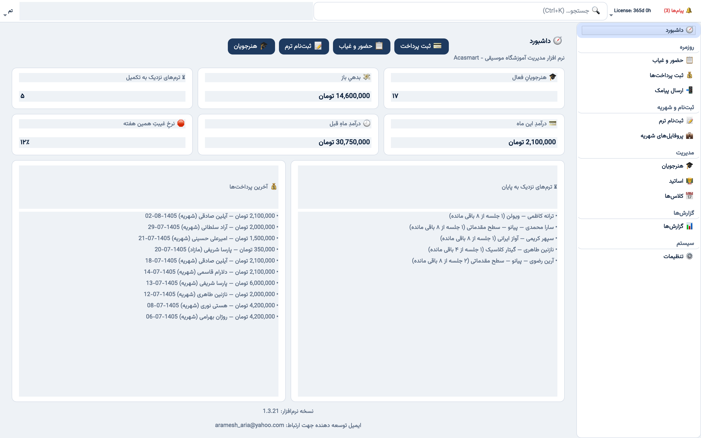
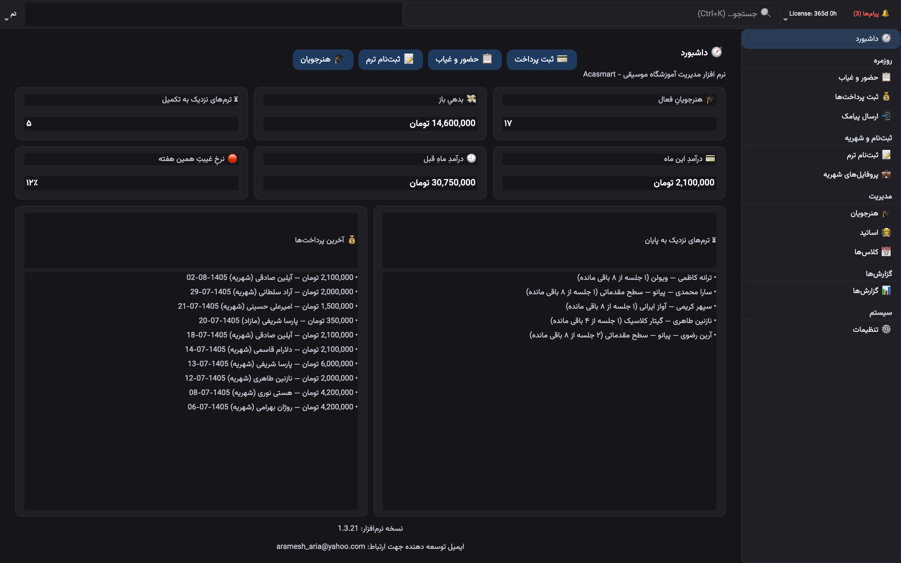
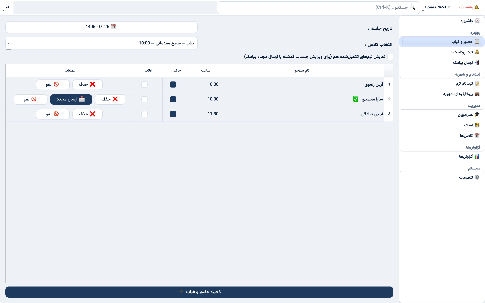
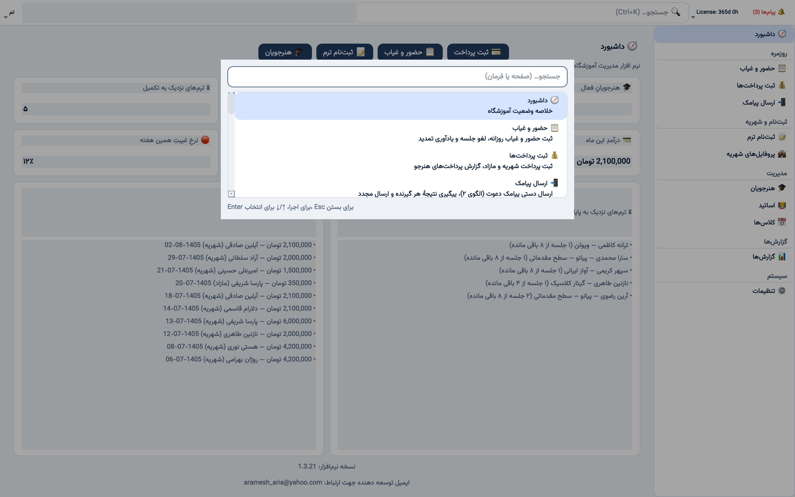
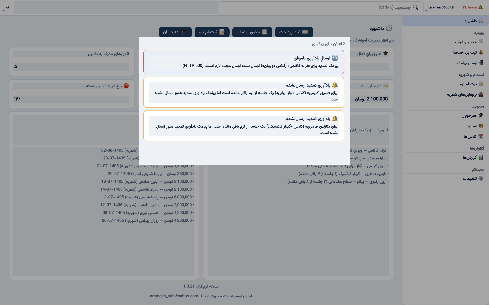
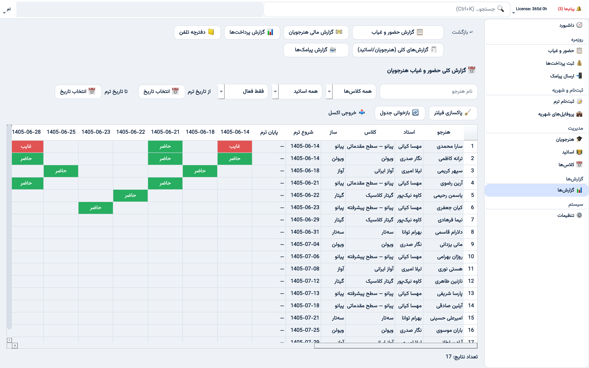
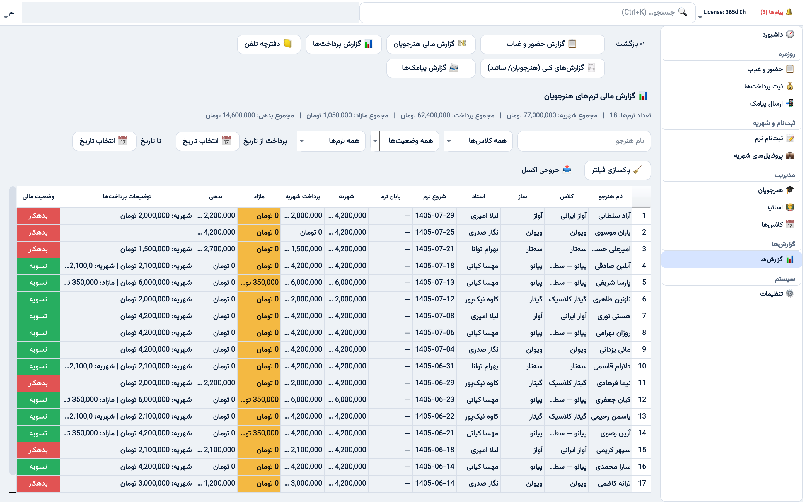
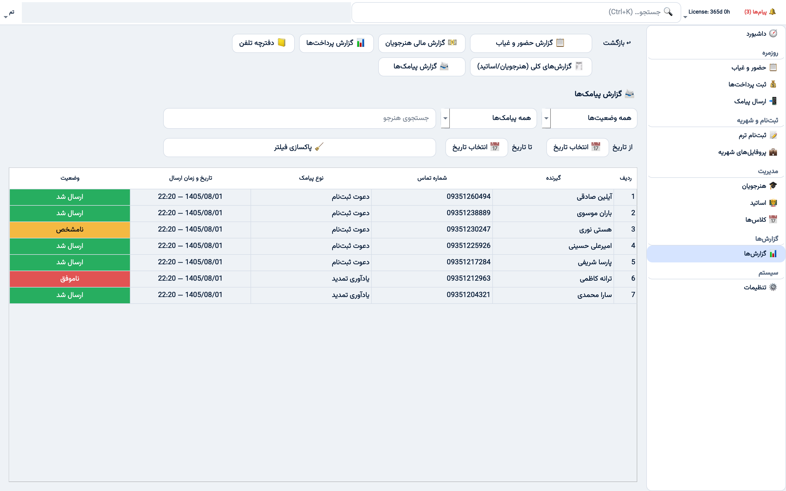
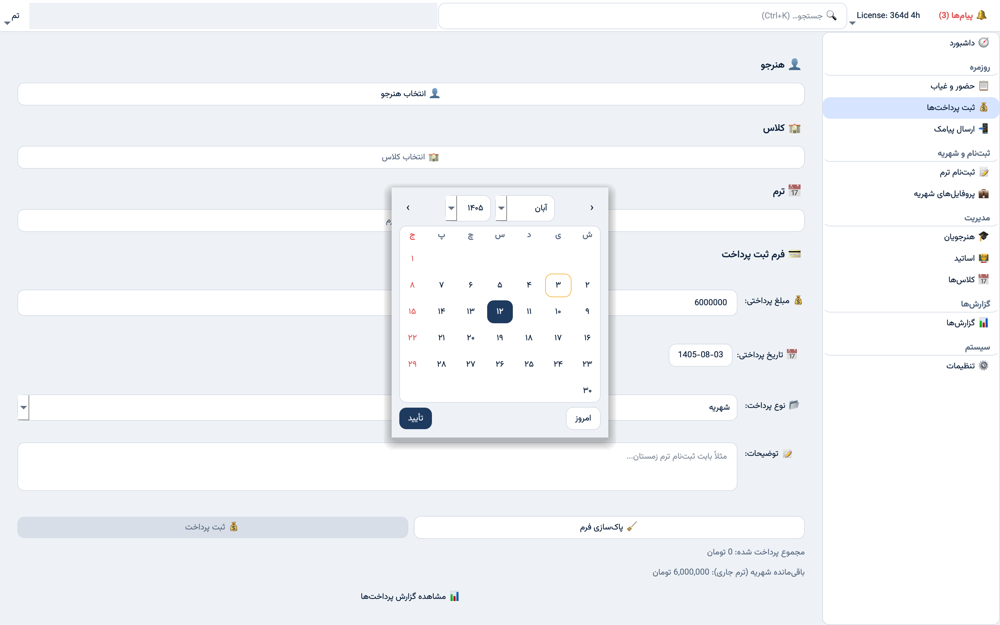
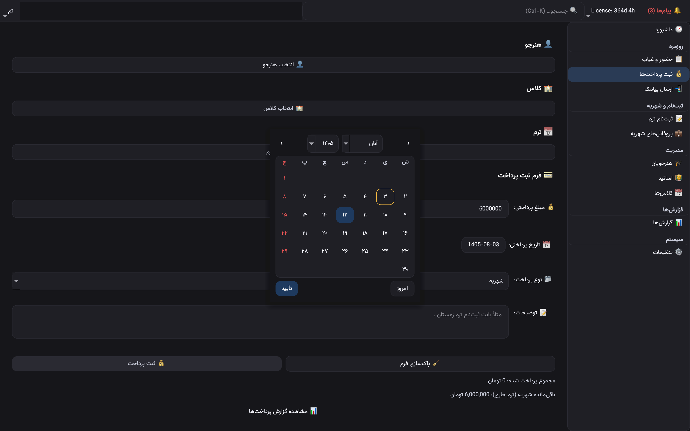

# AcaSmart — Music Academy Management Desktop App

**Persian RTL · PySide6 · SQLite · In production at a music academy since 2023**

[](LICENSE)
[](DEPLOYMENT.md)
[-green)](https://www.qt.io/)
[-orange)](TEST_STRATEGY.md)
[-black)](DEPLOYMENT.md)



---

## 🎯 For Hiring Managers — 30-Second Summary

| Aspect | Detail |
|--------|--------|
| **Role** | Sole developer — requirements → domain modeling → architecture → implementation → tests → packaging → releases |
| **Scale** | Production desktop app, used daily by the admin of a music academy; 12+ tagged releases (current: `v1.4.0`) |
| **Hardest problems solved** | Schedule-as-truth domain model (no `sessions` table), derived & reversible term completion, three-state attendance with reschedule-as-cancellation, SMS sends moved off the UI thread with an exact-outcome ledger, Ed25519 offline license system with device binding & trial |
| **Tech depth** | SQLite migrations v2–v8 (WAL, online-backup before every migration), Shamsi/Jalali calendar throughout, single-window sidebar shell with Ctrl+K command palette, token-based light/dark theming, cross-platform PyInstaller builds from CI |
| **Testing** | **653 pytest tests** — domain/repo tests over real SQLite **plus ~540 headless pytest-qt GUI tests** that drive real pages (save attendance, send SMS through a fake transport, navigate the shell); CI on Windows (Py 3.8 & 3.11), macOS and Linux |
| **Delivery** | One GitHub Actions workflow builds **5 targets** — Windows 7 & Windows 10 installers, macOS arm64 & Intel apps, Linux bundle — and attaches them to the release |

**Live demo:** [Video walkthrough](https://aria-aramesh.ir/public/media/portfolio/project-1-demo.mp4) (recorded on v1.1, before the shell redesign) · [Screenshots](SCREENSHOTS/) · gallery below

---

## 📖 Documentation Index

| Document | Audience | Purpose |
|----------|----------|---------|
| [ARCHITECTURE.md](ARCHITECTURE.md) | Engineers | Layered architecture, data flow, module map |
| [DOMAIN_MODEL.md](DOMAIN_MODEL.md) | Engineers/PMs | Canonical domain vocabulary, invariants |
| [TECHNICAL_DECISIONS.md](TECHNICAL_DECISIONS.md) | Architects | 14 ADRs with trade-off tables |
| [TEST_STRATEGY.md](TEST_STRATEGY.md) | QA/Leads | Test philosophy, GUI testing, CI matrix |
| [DEPLOYMENT.md](DEPLOYMENT.md) | DevOps/Engineers | Build pipeline, release process, license operations |
| [COMMERCIAL.md](COMMERCIAL.md) | Buyers/Partners | Licensing terms, pricing model, support |
| [VIDEO_DEMO.md](VIDEO_DEMO.md) | Everyone | Demo video guide + screenshot index |

---

## 🏗️ Architecture at a Glance

```
SQLite DB (WAL, FK=ON, PRAGMA user_version migrations)
    ↓
data/db.py          → get_connection(): context manager — commit / rollback / always close
data/repos/*.py     → Plain-function repos (no classes), one module per domain
core/*.py           → Domain rules: schedule math, license, config (zero UI imports)
services/*.py       → Use cases: record attendance, renewal reminder, SMS worker, backup, notification feed
ui/shell.py         → One ShellWindow: sidebar + stacked pages, single navigate_to() hub
ui/pages/*.py       → One thin page per module (built once, refreshed on activation)
```

**Key principles:**
- Domain logic in `core/`, `data/` and `services/` has **zero UI imports** — testable in isolation.
- **Every navigation path** (sidebar, Ctrl+K palette, notification cards, in-page links) goes through `ShellWindow.navigate_to()`.
- The only network dependency (SMS provider) runs on a **`QThread` worker**; the UI never blocks on it.

---

## ✨ Standout Features

| Feature | Technical Highlight |
|---------|---------------------|
| **Schedule-as-truth** | No `sessions` table — lessons computed weekly from the enrollment; attendance is the only record of what happened |
| **Derived term completion** | Complete when Present + Absence reach the session limit; reversible — deleting attendance re-opens the term |
| **Three-state attendance** | `Present` / `Absence` / `Canceled`; reschedule = cancel old + attend new (net 1 session) |
| **Snapshotted pricing** | Tuition & session limit frozen at enrollment; resolved Term → Pricing Profile → default setting |
| **Sidebar shell + Command Palette** | Single window, 11 modules in sections, Ctrl+K palette for navigation, theme toggle and instant backup |
| **KPI dashboard** | Active students, outstanding debt, near-completion terms, this/last month revenue, weekly absence rate |
| **Renewal SMS off the UI thread** | Fires when exactly 1 session remains; `QThread` worker reports the exact provider status; ledger marks *sent* only on explicit success |
| **Notification Center** | Badge + card dialog from purely local data: reminder-sendable terms and failed/unknown sends, each routed to the right page |
| **SMS Delivery Report** | Append-only send log (migration v8) — every attempt with recipient, kind, outcome and time; filterable |
| **Verified backup / restore** | WAL-safe online backup, validated before restore, guarded by confirmation |
| **Ed25519 license system** | Offline validation, hardware-bound device fingerprint, 7-day trial, yearly expiry, key rotation |
| **Shamsi/Jalali throughout** | All business dates Persian calendar; Jalali-native date picker (own month grid, no Gregorian widget underneath); "today" pinned to Iran time (fixed UTC+3:30, immune to stale DST rules on Windows 7); Persian collation; full RTL |

---

## 🖼️ Screenshots

All screenshots use fictional demo data.

| | |
|---|---|
|  **Dashboard** — KPI cards, near-completion terms, recent payments |  **Dark theme** — same tokens, swapped palette |
|  **Attendance** — computed roster, cancel, resend reminder |  **Ctrl+K command palette** |
|  **Notification Center** — failed & due reminders |  **Attendance report** — per-date status grid, Excel export |
|  **Financial report** — tuition, extras, debt per term |  **SMS Delivery Report** — append-only send log |
|  **Jalali date picker** — month/year dropdowns, Persian digits, Friday and today marked |  **Date picker, dark theme** — same grid on the dark tokens |

More in [SCREENSHOTS/](SCREENSHOTS/) and the index in [VIDEO_DEMO.md](VIDEO_DEMO.md).

---

## 🛠️ Tech Stack

| Layer | Technology |
|-------|------------|
| Language | Python 3.8 (Windows 7 track) + 3.11 (Windows 10/11, macOS, Linux) |
| UI | PySide6 (Qt 6), sidebar shell (`QListWidget` + `QStackedWidget`), token-based QSS theming (light/dark), RTL |
| Concurrency | `QThread` + signals for SMS sends (the only network I/O) |
| Database | SQLite (`foreign_keys=ON`, WAL, `PRAGMA user_version` migrations v2–v8) |
| Dates | `jdatetime` / `jalali-core` — Shamsi `YYYY-MM-DD` stored as text |
| SMS | IPPanel (pattern-based templates) |
| Reporting | pandas / openpyxl (Excel export) |
| Packaging | PyInstaller + Inno Setup (Windows), PyInstaller `.app` (macOS), PyInstaller one-dir (Linux) |
| CI/CD | GitHub Actions — test matrix on 4 OS/Python configs; build workflow for 5 targets; ruff lint |
| Crypto | `cryptography` (Ed25519), `keyring` (trial persistence) |
| Testing | pytest, pytest-qt (headless `offscreen`), 653 tests |

---

## 📦 Releases & Distribution

- **12+ tagged releases** (current: `v1.4.0`)
- Built by CI on every `v*` tag and attached to the GitHub Release:

| Asset | Platform |
|-------|----------|
| `AcaSmart-<ver>-win7-x64-setup.exe` | Windows 7 / 8 (Python 3.8 track) |
| `AcaSmart-<ver>-win10-x64-setup.exe` | Windows 10 / 11 |
| `AcaSmart-<ver>-macos-arm64.zip` | macOS 11+ Apple Silicon |
| `AcaSmart-<ver>-macos-x86_64.zip` | macOS 11+ Intel |
| `AcaSmart-<ver>-linux-x86_64.tar.gz` | Linux x86_64 (glibc 2.35+) |

- License activation on first run (trial or key)

---

## 🧪 Testing Strategy

```
tests/
├── test_enrollment.py, test_term_progress.py, test_term_config.py   # domain rules over real SQLite
├── test_attendance_recording.py, test_renewal_reminder.py           # use cases, fake SMS transport
├── test_notification_feed.py, test_payments_repo.py, ...            # eligibility, debt caps
├── integration/test_license_e2e.py                                  # trial → activate → expire → renew
└── unit/                                                            # ~540 tests, mostly pytest-qt
    ├── test_attendance_page.py, test_sms_page.py, test_reports_page.py, ...   # real page flows
    ├── test_shell.py, test_command_palette*.py, test_notification_center.py   # navigation hub
    ├── test_sms_worker.py, test_backup_service.py, test_connection_lifecycle.py
    └── test_retired_patterns.py, test_platform_conformance.py                 # architecture guards
```

**Philosophy:** test behaviour at the seams users touch — repos and services against a real SQLite file, pages driven headlessly through pytest-qt, and guard tests that stop retired patterns from coming back. See [TEST_STRATEGY.md](TEST_STRATEGY.md).

---

## 🚀 What's Next (Roadmap)

- [x] GitHub Actions CI (pytest on push; Windows Py 3.8/3.11, macOS, Linux)
- [x] Headless widget tests (`QT_QPA_PLATFORM=offscreen`, pytest-qt)
- [x] Automated cross-platform release builds
- [x] Deeper modules: term progress, attendance recording, renewal reminder, enrollment, config seam
- [ ] Optional cloud backup for the app-data DB
- [ ] Code signing / notarization (Windows Authenticode, Apple Developer ID)
- [ ] Clock-rollback detection for licenses

---

## 📄 License

**Functional Source License 1.0 — Apache-2.0 Future Grant (2-year delay)**

This repository is a **professional showcase**. Source is viewable for evaluation. Commercial use requires a separate license.

→ See [LICENSE](LICENSE) for full terms  
→ See [COMMERCIAL.md](COMMERCIAL.md) for purchasing / licensing inquiries

---

## 📞 Contact

**Ahmad (Aria) Aramesh Moghaddam**  
Python/Django Developer — Desktop & Backend Systems  
📧 aramesh_aria@yahoo.com · 🔗 [github.com/Aramesh-Aria](https://github.com/Aramesh-Aria)  
📍 Open to opportunities — backend, desktop, domain-driven design, systems architecture
